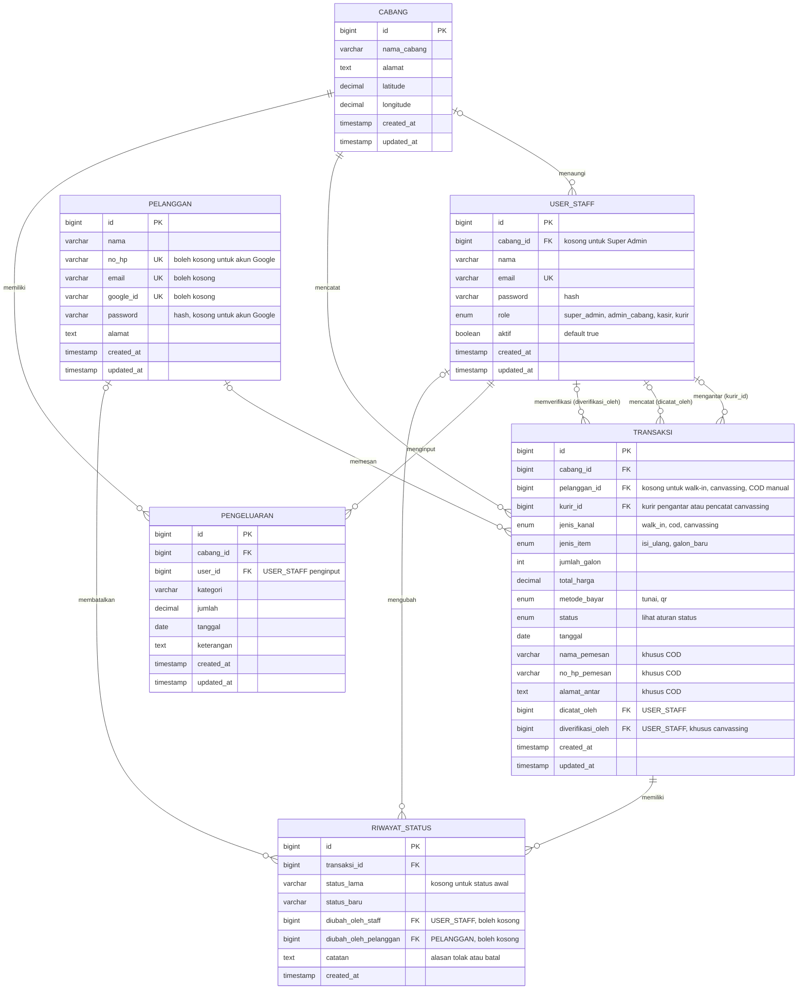

# ERD — SIGALON

**Versi:** 1.1 (25 Oktober 2026), sesuai Dokumentasi SIGALON v1.1 dan PRD v1.2  
**Isi:** 6 tabel inti — CABANG, USER_STAFF, PELANGGAN, TRANSAKSI, RIWAYAT_STATUS, PENGELUARAN

Tabel bawaan framework (notifikasi Laravel, token Sanctum, sesi) tidak digambar. Semua tabel memakai `created_at` dan `updated_at` bawaan Laravel. Harga tidak disimpan di tabel, melainkan di file konfigurasi aplikasi.

## Diagram

## Relasi

Semua relasi satu-ke-banyak.

| Dari | Ke | Kolom FK | Wajib? | Keterangan |
|---|---|---|---|---|
| CABANG | USER_STAFF | `cabang_id` | Tidak | Kosong hanya untuk Super Admin |
| CABANG | TRANSAKSI | `cabang_id` | Ya | Dasar pembatasan data per cabang |
| CABANG | PENGELUARAN | `cabang_id` | Ya | |
| PELANGGAN | TRANSAKSI | `pelanggan_id` | Tidak | Terisi hanya untuk COD online |
| USER_STAFF | TRANSAKSI | `kurir_id` | Tidak | Kurir yang ditugaskan (COD) atau pencatat (canvassing) |
| USER_STAFF | TRANSAKSI | `dicatat_oleh` | Tidak | Kasir/staf yang mencatat; kosong untuk pesanan online |
| USER_STAFF | TRANSAKSI | `diverifikasi_oleh` | Tidak | Kasir yang menerima/menolak canvassing |
| USER_STAFF | PENGELUARAN | `user_id` | Ya | Admin Cabang penginput |
| TRANSAKSI | RIWAYAT_STATUS | `transaksi_id` | Ya | Satu baris per perubahan status COD/canvassing |
| USER_STAFF | RIWAYAT_STATUS | `diubah_oleh_staff` | Tidak | Terisi bila staf yang mengubah |
| PELANGGAN | RIWAYAT_STATUS | `diubah_oleh_pelanggan` | Tidak | Terisi bila pelanggan membatalkan |

Pada setiap baris RIWAYAT_STATUS, tepat satu dari `diubah_oleh_staff` atau `diubah_oleh_pelanggan` terisi.

## Aturan nilai kolom

**Status TRANSAKSI per kanal**

| `jenis_kanal` | Nilai `status` | Transisi yang diizinkan |
|---|---|---|
| `walk_in` | `selesai` | Langsung `selesai` saat disimpan |
| `cod` | `diproses`, `dijemput`, `diantar`, `selesai`, `dibatalkan` | `diproses → dijemput → diantar → selesai`; `diproses → dibatalkan` |
| `canvassing` | `menunggu_verifikasi`, `tervalidasi`, `ditolak` | `menunggu_verifikasi → tervalidasi`; `menunggu_verifikasi → ditolak → menunggu_verifikasi` |

**Kolom yang terisi per kanal**

| Kolom | Walk-in | COD online | COD manual | Canvassing |
|---|---|---|---|---|
| `pelanggan_id` | – | ✔ | – | – |
| `kurir_id` | – | ✔ (setelah ditugaskan) | ✔ (setelah ditugaskan) | ✔ |
| `jenis_item` | `isi_ulang` / `galon_baru` | `isi_ulang` | `isi_ulang` | `isi_ulang` |
| `nama_pemesan`, `no_hp_pemesan`, `alamat_antar` | – | ✔ | ✔ | – |
| `dicatat_oleh` | ✔ | – | ✔ | ✔ |
| `diverifikasi_oleh` | – | – | – | ✔ (setelah diverifikasi) |
| Harga satuan (dari file konfigurasi) | Rp6.000 / harga galon baru | Rp7.000 | Rp7.000 | Rp7.000 |

**Akun PELANGGAN**

| Jenis akun | `no_hp` | `password` | `email` | `google_id` |
|---|---|---|---|---|
| Nomor HP | ✔ | ✔ | – | – |
| Google | diisi saat pesanan pertama | – | ✔ | ✔ |

`no_hp`, `email`, dan `google_id` unik bila terisi. Kedua jenis akun tidak digabung otomatis.
